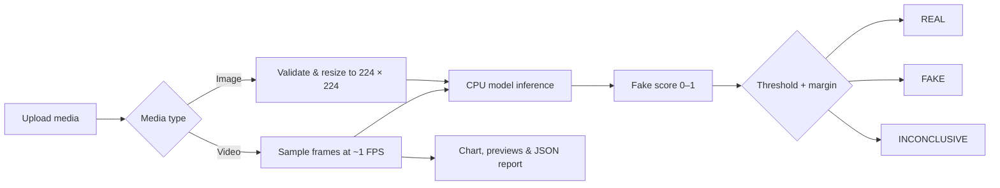

<div align="center">

# DeepTrace AI

### A practical, privacy-friendly workspace for spotting synthetic media

Upload an image or a short video, inspect the model's evidence, and make a
careful first-pass assessment — right from your browser.

<p>
  
  
  
  
</p>

<p>
  <strong>Image screening</strong>&nbsp; • &nbsp;
  <strong>Video frame analysis</strong>&nbsp; • &nbsp;
  <strong>Transparent scores</strong>&nbsp; • &nbsp;
  <strong>Runs locally</strong>
</p>

</div>

---

## What is DeepTrace?

DeepTrace is a small, focused Gradio application built around a trained
EfficientNetB0-style image classifier. It turns a model score into an
understandable result — **REAL**, **FAKE**, or **INCONCLUSIVE** — instead of
pretending that one number is a forensic verdict.

The interface is designed for quick investigation:

| Image analysis | Video analysis |
| --- | --- |
| JPG, JPEG, PNG, and WEBP uploads | MP4, MOV, and WEBM uploads |
| Metadata and model score at a glance | Approximately one sampled frame per second |
| Configurable decision boundary | Score-over-time chart and selected frame previews |
| Technical JSON details | Downloadable JSON analysis report |

> **Model output is an indicator, not proof.** Use DeepTrace to prioritize
> review and support human judgment — never as the sole basis for a
> consequential decision.

## A quick look at the workflow



## Designed for review

<table>
<tr>
<td width="50%" valign="top">

### Tune the decision

Move the **fake decision threshold** and the **inconclusive margin** in the
UI. Borderline scores are surfaced as uncertain instead of being forced into
a confident label.

</td>
<td width="50%" valign="top">

### See the evidence

Video results include the average score, frame agreement, highest-scoring
timestamp, a score chart, and up to six selected frame previews.

</td>
</tr>
<tr>
<td width="50%" valign="top">

### Keep a record

Image technical details appear in the interface. Video analysis can be
downloaded as `outputs/video_analysis_report.json` for later review.

</td>
<td width="50%" valign="top">

### Stay local

The app is intended to run on your machine. It uses CPU inference by default
and does not require an external prediction API.

</td>
</tr>
</table>

## Run it locally

### 1. Prerequisites

- Python **3.12**
- FFmpeg available on your `PATH`
- The trained model at `models/final_deepfake_model.keras`

### 2. Create an environment

**Linux / macOS**

```bash
python3.12 -m venv .venv
source .venv/bin/activate
```

**Windows PowerShell**

```powershell
py -3.12 -m venv .venv
.venv\Scripts\Activate.ps1
```

### 3. Install dependencies

```bash
python -m pip install --upgrade pip
pip install -r requirements.txt
```

### 4. Check the model, then launch

```bash
python check_model.py
python app.py
```

Open **[http://127.0.0.1:7860](http://127.0.0.1:7860)** when the terminal
reports that the app is ready.

<details>
<summary><strong>Use a different model path or port</strong></summary>

The defaults can be overridden without editing source files:

```bash
MODEL_PATH=models/your_model.keras PORT=7860 python app.py
```

</details>

## Input limits

| Input | Accepted formats | Limits | Processing |
| --- | --- | --- | --- |
| Image | JPG / JPEG / PNG / WEBP | 20 MB, 40 megapixels | Converted to RGB and resized to 224 × 224 |
| Video | MP4 / MOV / WEBM | 100 MB, 60 seconds | Up to 60 frames sampled at approximately 1 FPS |

The app queues one analysis job at a time and performs inference on the CPU.

## Understanding the labels

The classifier returns a score interpreted as **P(fake)**:

```text
score ≤ threshold − margin     → REAL
score ≥ threshold + margin     → FAKE
otherwise                      → INCONCLUSIVE
```

For videos, the label also considers the average score and how many sampled
frames sit above the configured threshold. This is still frame-based analysis:
it does **not** model temporal consistency, audio, lip-sync, motion, identity,
or provenance.

## Project map

```text
DeepTrace-AI/
├── app.py                         # Gradio interface and orchestration
├── inference.py                  # Model loading, preprocessing, classification
├── video_utils.py                # Validation, sampling, aggregation, previews
├── check_model.py                # Model shape and smoke-test verification
├── Deepfake_Detection_Project.ipynb
├── test.ipynb
├── requirements.txt
└── models/
    └── final_deepfake_model.keras # Trained model used by the app
```

## Responsible use

Deepfake detection is difficult and model performance depends on the data,
compression, lighting, faces, and generation technique represented during
training. A high or low score can be wrong, and the score is **not calibrated
as a probability of manipulation**.

Do not use this tool as definitive evidence for legal, employment, safety,
financial, or reputational decisions. Preserve the original media, compare
with trusted sources, and include qualified human review.

## License

Released under the [MIT License](LICENSE).

<div align="center">

<sub>Built for careful media triage — not unquestioned certainty.</sub>

</div>
